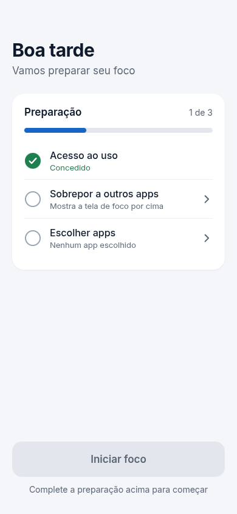
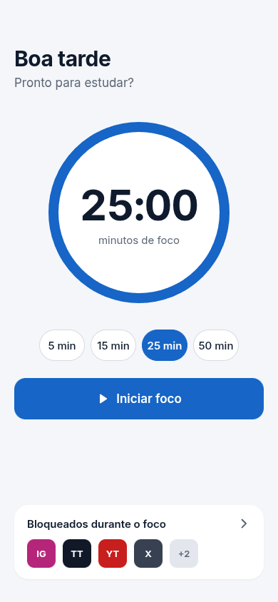
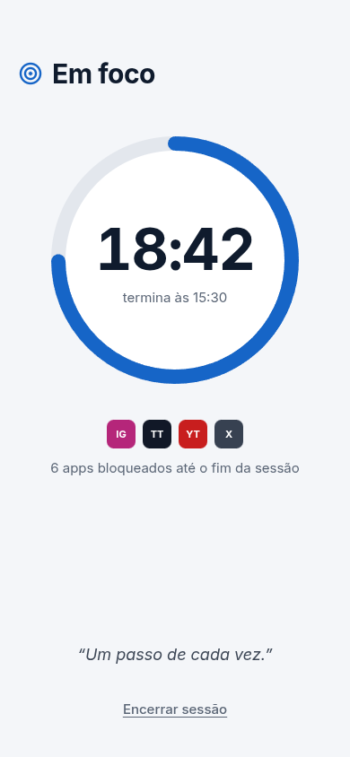
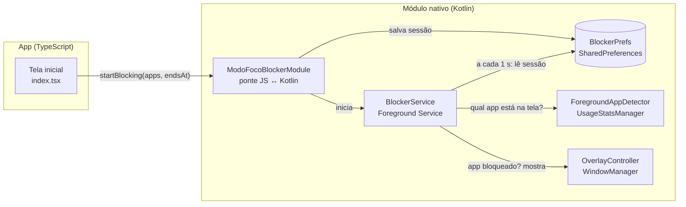

# Modo Foco

App Android que ajuda estudantes a vencer a procrastinação. Durante uma sessão de foco, ele bloqueia os apps que você escolheu, como Instagram e TikTok. Se você abrir um deles, aparece uma tela por cima: **"Você está em foco. Faltam X minutos"**.

O bloqueio não é punitivo. Dá para voltar ao foco com um toque, ou desbloquear o app por 1 minuto depois de esperar 5 segundos.

Feito com **React Native (Expo SDK 58)**, **TypeScript** e um **módulo nativo em Kotlin**.

## Telas

<table>
  <tr>
    <td align="center"><br><sub>Preparação (primeiro uso)</sub></td>
    <td align="center"><br><sub>Pronto para focar</sub></td>
    <td align="center"><br><sub>Sessão em andamento</sub></td>
  </tr>
</table>

<sub>Imagens do protótipo de design. No app, os apps bloqueados aparecem com os ícones reais instalados no celular.</sub>

## Como funciona

1. **Preparação.** O usuário libera duas permissões especiais, "Acesso ao uso" e "Sobrepor a outros apps", e escolhe quais apps bloquear.
2. **Sessão.** Ao tocar em "Iniciar foco", o app salva a lista de apps e o horário de término, e inicia um serviço em segundo plano.
3. **Vigilância.** A cada 1 segundo, o serviço pergunta ao Android qual app está na tela. Se for um app bloqueado, ele desenha o overlay por cima.
4. **Fim.** Quando o horário de término passa, o serviço remove o overlay, apaga a notificação e se encerra sozinho, mesmo com o Modo Foco fechado.



## Como foi feito

### Por que um módulo nativo?

O React Native não tem nenhuma API para saber qual app está aberto, nem para desenhar por cima de outros apps. Isso só existe no Android nativo. Por isso criamos um **módulo local do Expo** (`npx create-expo-module --local`) em [`modules/modo-foco-blocker`](modules/modo-foco-blocker). O Expo compila esse módulo junto com o app e expõe as funções Kotlin para o TypeScript:

```ts
hasUsagePermission(): boolean
openUsageSettings(): void
hasOverlayPermission(): boolean
openOverlaySettings(): void
getLaunchableApps(): Promise<{ packageName: string; label: string; icon: string }[]>
startBlocking(packages: string[], endsAt: number): void
stopBlocking(): void
isBlocking(): boolean
```

### Os arquivos Kotlin

Todos estão em [`modules/modo-foco-blocker/android/src/main/java/expo/modules/modofocoblocker/`](modules/modo-foco-blocker/android/src/main/java/expo/modules/modofocoblocker), comentados em português.

| Arquivo | Responsabilidade |
|---|---|
| `ModoFocoBlockerModule.kt` | Ponte entre JS e Kotlin. Só repassa as chamadas para os outros arquivos. |
| `PermissionHelper.kt` | Verifica as permissões (`AppOpsManager`, `Settings.canDrawOverlays`) e abre as telas das Configurações. |
| `AppListHelper.kt` | Lista os apps da gaveta de apps e converte cada ícone em PNG base64. Nunca lista o próprio Modo Foco, os launchers nem as Configurações. |
| `BlockerPrefs.kt` | Guarda a sessão (apps, horário de término, desbloqueio temporário) no `SharedPreferences`. |
| `ForegroundAppDetector.kt` | Descobre o app na tela procurando o último evento `ACTIVITY_RESUMED` no `UsageStatsManager`. |
| `BlockerService.kt` | O Foreground Service. Mantém a notificação fixa, roda a verificação a cada segundo e se encerra no fim da sessão. |
| `OverlayController.kt` | Monta a tela de bloqueio em código e a adiciona ao `WindowManager` como `TYPE_APPLICATION_OVERLAY`. |

### Decisões técnicas

- **UsageStatsManager, e não AccessibilityService.** Um serviço de acessibilidade detecta a troca de app na hora, mas o Google Play restringe muito o uso dele fora da acessibilidade. O `UsageStatsManager.queryEvents` é a API feita para "saber o que foi usado", e verificar a cada 1 segundo é rápido o bastante.
- **Foreground Service do tipo `specialUse`.** Um serviço comum é encerrado pelo Android em poucos minutos com o app em segundo plano. O Foreground Service, com sua notificação fixa, continua rodando. A partir do Android 14 é obrigatório declarar o tipo; usamos `specialUse` com uma justificativa no manifest.
- **Sessão salva em disco.** O horário de término (`endsAt`) fica no `SharedPreferences`, e não na memória. Assim, se o Android recriar o serviço ou o usuário fechar o app, o serviço continua sabendo quando parar.
- **Overlay em vez de Activity.** Uma View no `WindowManager` aparece por cima de qualquer app sem trocar a tarefa atual, e some na hora quando o usuário sai do app bloqueado.
- **Permissões no manifest do módulo.** Todas as declarações (`PACKAGE_USAGE_STATS`, `SYSTEM_ALERT_WINDOW`, `FOREGROUND_SERVICE_SPECIAL_USE`, o `<service>`, o `<queries>`) ficam no [`AndroidManifest.xml`](modules/modo-foco-blocker/android/src/main/AndroidManifest.xml) do módulo e são mescladas automaticamente no app. Para listar os apps usamos `<queries>` com `MAIN`/`LAUNCHER`, sem a permissão `QUERY_ALL_PACKAGES`.
- **Não punitivo.** O botão "Desbloquear por 1 minuto" só fica ativo depois de 5 segundos, e encerrar a sessão pede só uma confirmação leve.

### A interface

- **Expo Router**, com as telas em [`src/app/`](src/app). A tela inicial ([`index.tsx`](src/app/index.tsx)) muda entre três estados: preparação, pronto e em foco. Cada estado é um componente em [`src/components/home/`](src/components/home).
- **O anel do timer** ([`progress-ring.tsx`](src/components/progress-ring.tsx)) é feito só com Views, sem SVG. Dois semicírculos recortados giram para desenhar o arco, o que evitou adicionar uma biblioteca nativa e gerar um novo build.
- **Design minimalista**: uma cor de destaque, cartões brancos e uma ação principal por tela.

## Estrutura do projeto

```
src/
  app/                    # telas (Expo Router)
    index.tsx             # tela inicial: preparação, pronto e em foco
    apps.tsx              # escolha dos apps bloqueados
  components/             # anel, ícones dos apps, painéis da tela inicial
  constants/theme.ts      # cores
  lib/storage.ts          # AsyncStorage: apps escolhidos e sessão atual
modules/modo-foco-blocker/
  index.ts                # API exportada para o TypeScript
  android/                # código Kotlin + AndroidManifest do módulo
```

## Como rodar

O app usa código nativo próprio, então **não funciona no Expo Go**. É preciso um *development build*.

```bash
npm install

# Opção 1: build na nuvem (não precisa de Android SDK no PC)
npx eas-cli@latest build --profile development --platform android
# → abra no celular o link do .apk que aparece no final e instale

# Opção 2: build local (precisa de Android SDK + JDK 17 ou 21)
npx expo run:android

# Depois, com o APK instalado, suba o servidor de JavaScript:
npx expo start
```

Mudanças só em TypeScript aparecem na hora (hot reload). Mudanças no Kotlin, no `AndroidManifest.xml` ou em dependências nativas exigem **um build novo**.

## Como testar no celular

1. Na tela inicial, o checklist **Preparação** mostra o que falta. Toque em **Acesso ao uso** e em **Sobrepor a outros apps** para liberar cada um nas Configurações. O checklist atualiza quando você volta para o app.
2. Toque em **Escolher apps** e marque, por exemplo, o Instagram.
3. Com tudo pronto, a tela inicial mostra o timer. Escolha **2 min** (essa opção só aparece em desenvolvimento) e toque em **Iniciar foco**. Permita as notificações. A notificação "Modo Foco ativo · Faltam 2 min" aparece.
4. Abra o Instagram: o overlay deve aparecer em até ~1 segundo.
5. **Voltar ao foco** leva de volta ao Modo Foco. **Desbloquear por 1 minuto** libera o app por 60 s.
6. Depois dos 2 minutos, o Instagram abre normalmente e a notificação some, mesmo com o Modo Foco fechado.

Para ver os logs do serviço (precisa do `adb` e da depuração USB ativada):

```bash
adb logcat -s ModoFoco
```

## Limitações conhecidas

- **Fabricantes que matam serviços.** Xiaomi (MIUI/HyperOS), Samsung, Huawei, Oppo e outros podem encerrar o serviço para economizar bateria, e aí o bloqueio para. Para evitar:
  - Nas Configurações, vá em **Apps → Modo Foco → Bateria** e escolha **Sem restrições** (ou "Não otimizar").
  - **Xiaomi:** ative também o **Início automático** e, em "Economia de bateria", escolha **Sem restrições**.
  - **Samsung:** em **Bateria → Limites de uso em segundo plano**, tire o Modo Foco de "Apps em suspensão".
  - Guia por fabricante: <https://dontkillmyapp.com>
- **Atraso de até ~1 segundo.** A verificação é feita a cada segundo, então o app bloqueado pode aparecer por um instante antes do overlay.
- **Não é à prova de burla.** O usuário pode tirar as permissões nas Configurações ou forçar a parada do Modo Foco. A ideia é ajudar, não punir.
- **Só Android.** O iOS não permite este tipo de bloqueio sem a API Screen Time, que exige uma permissão especial da Apple.
- **Google Play.** Apps com `PACKAGE_USAGE_STATS`, sobreposição e foreground service do tipo `specialUse` precisam justificar o uso na revisão da loja.
